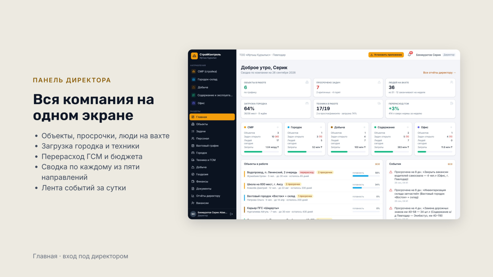
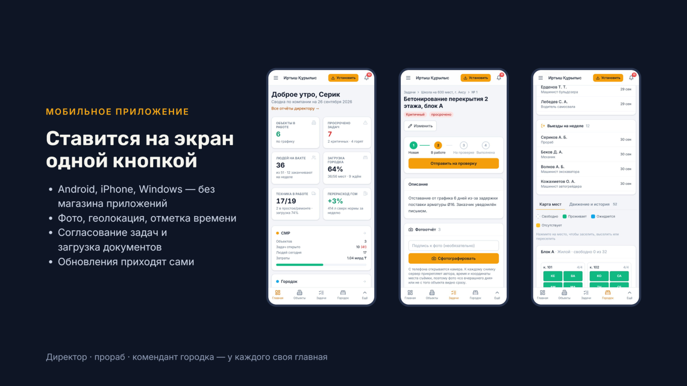
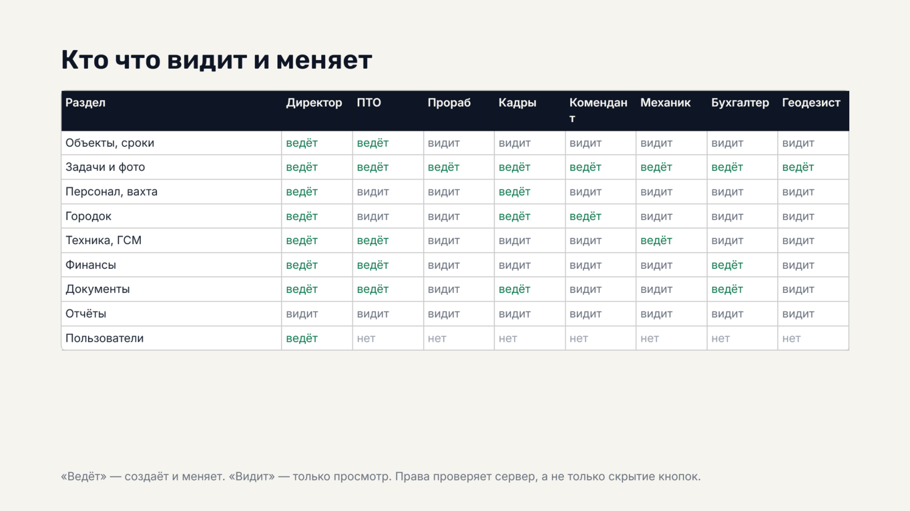

# StroyKontrol — Managementsystem für ein Bauunternehmen (Showcase)

> 🇬🇧 [English version](README.md)

**Ein System für ein Bauunternehmen: Baustellen, Aufgaben mit Fotobericht, Schichtpersonal und Arbeiterwohnlager, Baumaschinen und Kraftstoff, Soll/Ist-Budget, Dokumentenfreigabe und acht Berichte für die Geschäftsführung** — vollständig entwickelt von [Johannes Braun](https://github.com/DjonnnBraunnn).

Dies ist ein **Showcase-Repository** mit ausgewählten Modulen aus der privaten Codebasis. Das System entsteht für ein Bauunternehmen in Kasachstan und folgt der Struktur, die der Geschäftsführer selbst vorgegeben hat: Bauarbeiten, Wohnlager & Lager, Rohstoffabbau, Straßenunterhalt und Zentrale.

---

## 📸 Screenshots

*Dashboard der Geschäftsführung: das ganze Unternehmen auf einem Bildschirm — Baustellen, überfällige Aufgaben, Schichtpersonal, Lagerbelegung, Kraftstoff- und Budgetüberschreitungen.*

*Installierbare PWA: Der Polier fotografiert auf der Baustelle — Zeit und GPS-Position werden automatisch angehängt. Oberfläche auf Russisch, für einen Kunden in Kasachstan. Demo-Daten sind fiktiv.*

*Acht Rollen mit eigenem Arbeitsbildschirm; Berechtigungen werden auf dem Server geprüft, nicht nur in der Oberfläche ausgeblendet.*

## Was das System kann

- 🏗️ **Baustellen** — Auftraggeber, Vertrag, Budget, Soll/Ist-Termine, Fortschritt
- ✅ **Aufgaben** — Fristen, Priorität, Checkliste, Fotobericht mit Zeit und Koordinaten; Benachrichtigung bei Verzug, Friständerung und Abschluss (`backend/app/routers/tasks.py`)
- 👷 **Schichtplan** — wer bis wann auf welcher Baustelle ist; überlappende Schichten werden abgelehnt
- 🛏️ **Wohnlager** — Block → Zimmer → Bett, Ein-/Auszug, Umzug, Belegungsgrenzen und Historie (`backend/app/routers/camp.py`)
- 🚜 **Technik & Kraftstoff** — Fahrtenbücher, Motorstunden, Verbrauch gegen Norm, Überschreitungen
- 💰 **Finanzen** — Soll/Ist je Baustelle, Ausgaben, Abnahmeprotokolle, Zahlungen
- 📄 **Dokumente** — Versionen und Freigabeliste; eine neue Version setzt die Freigaben zurück (`backend/app/routers/documents.py`)
- 📊 **Acht Berichte** — täglich / wöchentlich / monatlich, Excel-Export (`backend/app/routers/reports.py`)
- ⏰ **Täglicher Scheduler** — Verzug, anstehende Ein-/Auszüge, ohne doppelte Benachrichtigungen (`backend/app/scheduler.py`)

## Tech-Stack

| Ebene | Technik |
|---|---|
| Backend | Python · FastAPI · SQLAlchemy 2 · JWT |
| Datenbank | PostgreSQL (SQLite lokal) |
| Frontend | Next.js 14 (App Router) · TypeScript · Tailwind · SVG-Diagramme ohne Chart-Bibliothek |
| Mobil | PWA: Installation, Kamera, Geolokalisierung, Service Worker |
| Betrieb | Docker Compose hinter nginx, nächtliche Backups |

## Inhalt dieses Repositorys

| Datei | Was sie zeigt |
|---|---|
| `backend/app/models.py` | Domänenmodell; jede Tabelle mandantenfähig (`company_id`) |
| `backend/app/auth.py` | JWT; der Benutzer wird bei jeder Anfrage aus der DB gelesen — entlassene Mitarbeiter verlieren sofort den Zugang |
| `backend/app/routers/camp.py` | Bettgenaue Belegungslogik |
| `backend/app/routers/documents.py` | Versionierte Dokumente mit Freigabe-Workflow |
| `backend/app/routers/reports.py` | Aggregationen für die acht Berichte + Excel-Export |
| `backend/app/scheduler.py` | Tägliche Benachrichtigungen ohne Duplikate |
| `backend/tests/test_smoke.py` | End-to-End-Prüfung aller Bereiche, Rollen und Rechte |
| `frontend/lib/roles.ts` | Rollen-/Rechtematrix |
| `frontend/lib/api.ts` | Typisierter API-Client |
| `.env.example` | 12-Factor-Konfigurationsvorlage |

---

📫 **Kontakt:** braunjohannes595@gmail.com · Offen für Backend-/Full-Stack-Positionen (DE/remote).

*Der Code wird ausschließlich zur Bewertung als Portfolio veröffentlicht. Alle Rechte vorbehalten.*
